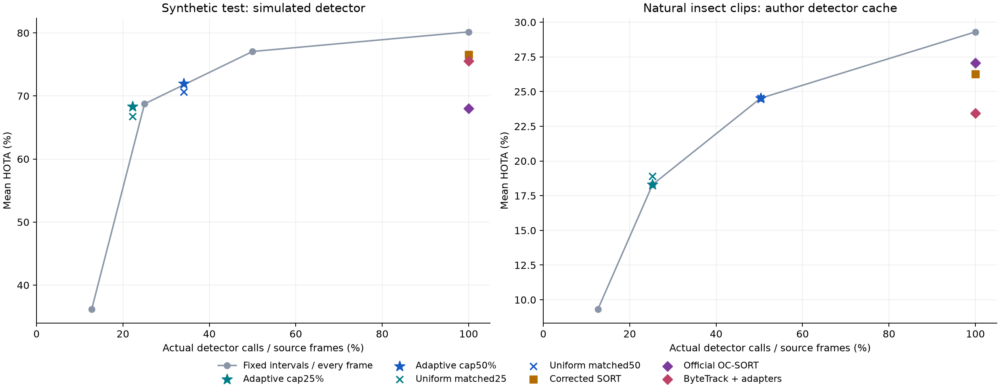

# Kinetic-Tracker

**Native C++ tracking, budgeted detection and reproducible multi-object tracking evaluation.**

This branch extends the original YOLO/OpenCV/SORT demo into an inspectable
experimental system. It asks when a detector can be skipped while preserving
identities and discovering newly visible objects. The application focus is
insect monitoring; current results are small-sample research evidence, not a
state-of-the-art or agricultural field-deployment claim.

**Start with [the measured report](results/REPORT.md), [offline results explorer](results/report.html),
[reproduction commands](docs/REPRODUCE.md) and [comparison video](results/gmot_comparison.mp4).**



## Implemented

- **C++17 detector:** OpenCV DNN/ONNX inference, tested aspect-preserving
  letterboxing, inverse coordinates, dynamic YOLOv8 tensor layouts and class-aware NMS.
- **Tracking core:** timestamp-aware eight-state Kalman motion, full box geometry,
  class-aware gated Hungarian matching, tentative/confirmed/lost states,
  observation-based expiry and explicit observed/predicted telemetry.
- **Association choices:** corrected SORT-style matching and a confidence-based
  two-stage implementation inspired by ByteTrack. It is not mislabelled as the
  full official ByteTrack implementation.
- **Budgeted scheduling:** covariance, overlap risk and a raw-frame foreground
  signal; a capacity-two token bucket enforces a causal detector-call budget.
  Uniform controls exactly match each adaptive run's total detector calls.
- **Evaluation:** pinned official TrackEval HOTA/AssA/IDF1/CLEAR metrics, official
  OC-SORT and ByteTrack tracking-only references, strict MOT validation,
  sequence splits, input hashes and documented compatibility adapters.
- **Evidence:** synthetic failure scenarios, natural GMOT-40 insect clips,
  processed bee/oracle diagnostics, real ONNX transfer probes, stage timings,
  repeated uncached CPU measurements and comparison videos.
- **Safety/reliability:** no default GUI window; rejected input/output collisions,
  validated timestamps/geometry, safe archive preparation, isolated Python
  dependencies, CTest and semantic/CLI/data/evaluation/rendering tests.

## What the measurements support

The frozen all-estimate-output study uses identical author-provided detections
on two natural GMOT-40 insect clips (348 frames). HOTA and IDF1 below are
**unweighted sequence means**, not pooled official benchmark scores.

| Method | Detector calls | HOTA | IDF1 |
| --- | ---: | ---: | ---: |
| Corrected SORT-style baseline | 100% | 26.25 | 35.89 |
| Local two-stage association | 100% | 29.30 | 41.36 |
| Official OC-SORT | 100% | 27.07 | 39.24 |
| Official ByteTrack with compatibility adapters | 100% | 23.43 | 32.72 |

These are association comparisons on supplied detector caches. They do not
establish the accuracy of this project's original ONNX detector, whose transfer
to the natural insect clips is weak and whose training provenance is missing.

At matched detector-call counts, adaptive scheduling has modest gains on the
synthetic suite. It **does not beat periodic detection on the natural test
clips**. Background motion saturates its risk trigger under the budget cap.
This negative result, per-sequence failures and the stronger references remain
visible in the report.

An output-policy diagnostic was added after inspecting first-pass test errors,
then checked on validation. It is explicitly **post-hoc exploratory analysis**.
The CLI now defaults to `active`, suppressing unmatched lost boxes from scored
output while preserving telemetry and deliberate-skip predictions. The primary
study explicitly retains `--output-policy all`; results from these policies are
not silently mixed. See [methodology](docs/METHOD.md).

## Quick start on the tested Windows setup

Prerequisites: an existing MSYS2 UCRT64 compiler/OpenCV4 SDK and Python. Exact
tested packages are in `requirements-lock.txt`; alternate setup is documented
in [REPRODUCE.md](docs/REPRODUCE.md).

```powershell
python -m venv .venv
.\.venv\Scripts\python.exe -m pip install --index-url https://pypi.org/simple -r requirements-lock.txt
.\scripts\build.ps1

.\scripts\run.ps1 --video test_video.mp4 --model best.onnx --association two_stage --threads 8 --output runs\demo --output-video runs\demo\annotated.mp4
```

The original model and sample remain available. `--preview` opens an optional
window; the default processes files headlessly. Use a fresh output directory
when preserving old runs. The system refuses to overwrite an input asset with
an output. Existing generated files in a selected run folder are replaced.
Confidence is the last detector score, not a calibrated tracking probability.

For the capped scheduler:

```powershell
.\scripts\run.ps1 --video test_video.mp4 --model best.onnx --association two_stage --schedule adaptive --target-rate 0.5 --risk-threshold 0.28 --novelty-threshold 0.00008 --max-gap 8 --threads 8 --output runs\adaptive
```

The budget includes an initial detector call:
`calls(n) <= floor(1 + target_rate * (n - 1))`. A finite clip can therefore show
slightly more than the nominal percentage. A maximum gap requests a refresh;
the hard budget takes precedence. Exact uniform rate-matched controls know the
clip horizon and final call count, so they are retrospective experimental controls.

## Data and reproducibility

```powershell
.\.venv\Scripts\python.exe tools\generate_synthetic.py
.\.venv\Scripts\python.exe tools\prepare_data.py --download --export-yolo
.\.venv\Scripts\python.exe tools\prepare_data.py --gmot --download

.\.venv\Scripts\python.exe tools\benchmark.py --dataset gmot40 --split test --configs configs\study.json --matched --output runs\gmot40_test
.\.venv\Scripts\python.exe tools\reference_benchmark.py --dataset gmot40 --split test --source provided
```

Downloads are pinned to official author/university sources with checksums and
safe extraction. GMOT insect images are retrieved selectively, avoiding the
full1.5GB archive. Raw data, `.venv`, detailed `runs/` and build products are
ignored by Git. [Data documentation](docs/DATA.md) records licence, annotation
quarantine, processed-image caveats and nominal timestamp assumptions.

The Monash images contain annotation-related ROI masks/counters. Oracle boxes
there isolate association and must not be presented as detector performance or
natural new-arrival evidence. GMOT capture FPS is unverified; discovery delays
are primarily reported in frames.

## Repository map

```text
include/kinetic/        Detector, tracker and scheduler APIs
src/                   Native C++ implementation and CLI
tests/                 C++ and Python semantic/integration tests
tools/                 Data, benchmarks, references, timing, videos and report
configs/               Frozen splits, scheduler selection and study settings
third_party/           Pinned official source subsets, licences and provenance
results/               Compact measured tables, figures, reports and demo videos
docs/                  Methodology, architecture, data, related work and reproduction
scripts/               Windows build/test and DLL-path helpers
main.cpp               Untouched original implementation, retained for reference
```

The original README is preserved in [docs/ORIGINAL_README.md](docs/ORIGINAL_README.md).
The earlier notebook and plotting script are historical artifacts, not the new
evaluation pipeline.

## Branch workflow

Development belongs on `research/compute-aware-tracking`; `main` remains the
original project. See [VS Code/Git instructions](docs/GIT_WORKFLOW.md) to publish
the branch and optionally open a draft PR without merging it. Share the feature
branch URL with reviewers once pushed.

## Attribution

This work builds on SORT, ByteTrack, OC-SORT and established detection-scheduling
research, including DriftSched. It does not claim to invent covariance-based
scheduling. Primary references are in [RELATED_WORK.md](docs/RELATED_WORK.md).
Pinned code and compatibility changes are documented in `third_party/`.

Project code retains the existing MIT licence. GMOT-40 data/derived videos retain
their CC BY-NC-SA4.0 attribution; Monash data use CC BY4.0. Dataset terms do not
change the separately licensed source code. Each demo includes an attribution
and provenance sidecar.
