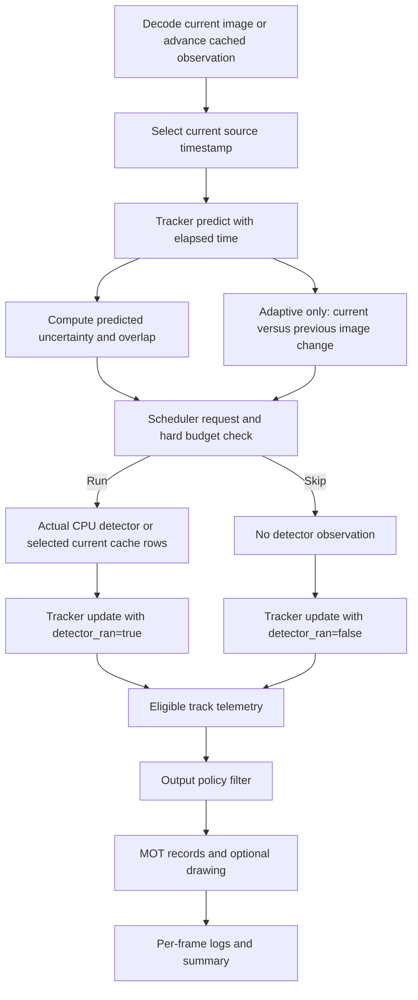

# Architecture

The build is a synchronous C++17/OpenCV application plus Python experiment tools.
OpenCV may parallelize internal CPU kernels through `--threads`; the application
does not implement asynchronous detection, GPU inference, network serving or a
camera-processing deadline guarantee. The original root `main.cpp` is preserved
as historical project code; the current CMake executable uses `src/main.cpp`.

## Components and contracts

| Component | Responsibility and boundary |
|---|---|
| `include/kinetic/detector.hpp`, `src/detector.cpp` | Letterbox geometry, image preprocessing, objectness-free YOLOv8 output decoding, class-wise NMS and CPU OpenCV DNN inference. `Detection` boxes leave this module in original-image pixels. |
| `include/kinetic/tracker.hpp`, `src/tracker.cpp` | Eight-state timestamp-aware Kalman tracks, pre-gated class-aware rectangular assignment, optional two-stage association, track lifecycle and bounded risk signals. `confidence` is the last detector score. |
| `include/kinetic/scheduler.hpp` | Header-only deterministic/seeded schedules and hard call-budget enforcement. Consumes numeric causal signals and observation index; it has no image, detector-cache or GT access. |
| `src/main.cpp` | CLI validation, video/image/cache inputs, timestamp selection, cheap scene-change calculation, predict/decide/detect/update orchestration, output-policy filtering, telemetry, optional rendering and timing. |
| `tools/prepare_data.py`, `tools/generate_synthetic.py` | Provenance-aware prepared data, split manifests, complete frame-time tables and explicitly synthetic experiments. |
| `tools/cache_detector.py` | Original-ONNX detection caches and model/input provenance for quality experiments. A cache is not live inference. |
| `tools/benchmark.py`, `tools/tune_scheduler.py` | Experiment commands, fingerprints, validation selection, frozen study runs and retrospective exact-call-count uniform controls. |
| `tools/evaluate.py` | Validated MOT input adapter calling pinned official TrackEval metrics. |
| `tools/run_reference.py`, `tools/reference_benchmark.py` | Separate pinned official OC-SORT/ByteTrack association runs on identical cached input, with compatibility and timing scope recorded. |
| `tools/runtime.py` | Separate uncached CPU timing on the unlabelled original sample with repeated alternating-order runs. |

`kinetic_core` is the reusable CMake library containing detector and tracker source.
`kinetic_tracker` adds the application orchestrator; the scheduler remains testable
without OpenCV. Unit tests cover tracker, scheduler, detector geometry/decoding and
Python evaluation/data/CLI behavior. The interfaces allow cache replay to exercise
tracking without initializing detector weights.

## Per-frame flow

`predict(timestamp)` must run before decision/update. The scheduler sees predicted
states from prior observations and, in adaptive mode, current raw image change.
It decides before current cached boxes or inference results are used. No GT is
passed into the C++ application. A skipped call differs from a detector that ran
and returned zero boxes: the latter is negative observation evidence and can mark
confirmed tracks lost.

The risk signals consider internally retained tracks, including states no longer
returned because their prediction-output horizon elapsed. The image-change mask
uses the returned non-tentative boxes, including eligible lost tracks. Changing
`--output-policy` affects emitted results/rendering, not this scheduler state or
the actual association decisions.

## Input modes and time

- **Uncached inference:** `--model` with `--video` or `--images`. Detection is run
  only on selected frames. The first blank-image inference warms the network
  outside measured steady processing time.
- **Cached replay:** `--detections` with explicit frame count and timestamps.
  Detection rows are `frame,timestamp,x,y,w,h,score,class_id`; zero-detection frames
  remain represented by the complete frame-time table. Adaptive replay also needs
  images because novelty cannot be inferred from detector rows.
- **Images:** source paths are sorted lexicographically; prepared images use
  zero-padded names. Frame metadata preserves original source indices and gaps.
- **Time:** complete `--frame-times` takes priority. The CLI rejects incomplete,
  non-increasing or negative time tables and inconsistent timestamps among rows
  of the same cache frame.
  Regular inputs can use nominal FPS. Source-derived or assumed timestamps remain
  labeled as such; physical sensor times are not manufactured from sparse labels.

Official Python reference trackers preserve their fixed step per update, so
timestamp-aware core comparisons include that declared difference on sparse data.
The exact matched uniform control additionally needs known horizon `N` and realized
adaptive count `K`, and is retrospective rather than an online scheduler.

Per-frame pairwise ambiguity is quadratic in retained track count, and augmented
assignment operates on a `(tracks+detections)` square matrix with cubic Hungarian
cost. Adaptive image differencing still reads the full source image on every
observation. Skipping a network forward therefore does not remove decoding,
image-change, tracker or output work, and saves no per-track crop computation.

## Outputs and visibility

Each run directory contains:

| File | Meaning |
|---|---|
| `mot.txt` | Evaluated/render-visible tracks, standard frame/id/xywh/score MOT rows. Tentative tracks are excluded. |
| `telemetry.csv` | Eligible returned tracks with timestamp, class, lifecycle state and `observed` flag, before active/all filtering. This is not a dump of every hidden internal state. |
| `detections.csv` | Boxes actually supplied on selected detector frames; intentionally skipped frames contribute no rows. |
| `frames.csv` | One row per processed observation: detector decision, visible output count, causal signals and stage/total timings. `tracks` is the output-visible count, not the internal track count. |
| `summary.json` | Input mode, policy/configuration, calls/rate, processing-time summary, OpenCV/thread settings and explicit timing scope. |

`--output-policy active` is the current CLI default. It hides eligible `lost`
tracks from MOT and rendering, while their eligible telemetry remains. Confirmed
predictions on intentional detector skips still appear; previously lost tracks
stay hidden until re-associated. `all` also emits eligible lost predictions.
Prediction horizon and final expiry still apply in both modes. This output choice
was introduced after initial held-out error inspection; primary frozen quality
benchmarks explicitly select `all`, and active/all comparisons are separate
post-hoc diagnostics. See `METHOD.md` for the evaluation chronology.

Observed boxes are drawn green and predicted boxes orange when preview/video is
requested. There is no UI-only filtering that silently changes evaluated boxes:
the same output-policy condition governs MOT emission and drawing. Input/output
collision checks prevent the fixed result filenames or output video from
overwriting the supplied model, video, cache, time file or source images.

## Reproducibility and limits

Experiment fingerprints retain commands and detector, GT, timestamp, executable
and evaluator hashes. Reference manifests record upstream commits, dependencies,
source hashes and compatibility details; cached reference update timings exclude
detector work. Quality aggregates distinguish synthetic perturbations, oracle
boxes, author-provided detector outputs and original ONNX predictions.

Processing wall time includes logging flush/finalization; initialization and warmup
are separate. Per-frame logging is not a sensor-to-display latency measurement.
The primary study, output-policy diagnostic and uncached runtime are separate
artifacts because they answer different questions. Original-model results on the
raw/provided real data remain weak; interfaces, tests and repeatable measurements
are engineering improvements, not evidence that a difficult vision task is solved.
