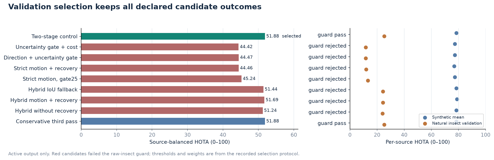

# Kinetic-Tracker: refinement evidence

**Frozen confirmation report**

At every-second-frame detection, hybrid motion changed mean HOTA from 35.82 to 36.55 (+0.74 points) across 9 additional clips with identical 893 detector calls. 6 clips improved and 3 regressed. Every-frame quality retained Two-stage control.

No new detector training. Quality results replay fixed detections; cached replay is not live detector throughput.

## Evidence scope

Validation selection uses the declared source-balanced criterion. Earlier insect/synthetic tests are reused exploratory evidence. Nine additional non-insect category clips were declared before scoring and evaluated after freeze; one clip per category does not establish full-benchmark or recording-independent generalisation.

## Validation candidates

source-balanced HOTA: .5*mean(synthetic6)+.5*raw insect-1

| Candidate | Balanced HOTA | Balanced IDF1 | Synthetic HOTA | Insect HOTA | Raw guard | Selected |
| --- | --- | --- | --- | --- | --- | --- |
| Two-stage control | 51.88 | 58.81 | 78.54 | 25.22 | pass | yes |
| Uncertainty gate + cost | 44.42 | 44.74 | 77.28 | 11.56 | rejected |  |
| Direction + uncertainty gate | 44.47 | 44.93 | 77.28 | 11.66 | rejected |  |
| Strict motion + recovery | 44.46 | 45.53 | 76.93 | 11.99 | rejected |  |
| Strict motion, gate25 | 45.24 | 47.20 | 77.29 | 13.19 | rejected |  |
| Hybrid IoU fallback | 51.44 | 57.65 | 78.54 | 24.34 | rejected |  |
| Hybrid motion + recovery | 51.69 | 58.34 | 78.99 | 24.39 | rejected |  |
| Hybrid without recovery | 51.24 | 57.35 | 78.54 | 23.94 | rejected |  |
| Conservative third pass | 51.88 | 58.81 | 78.54 | 25.22 | pass |  |

The current two-stage control produced byte-identical MOT outputs to the frozen v2 executable on 7/7 recorded validation cases.

## Budget association selection under fixed-2

Budget profile: motion_hybrid_full; schedule: adaptive50_legacy_all. This separate validation comparison uses fixed-2 detector availability and is not mixed with every-frame quality selection.

| Candidate | Balanced HOTA | Balanced IDF1 | Synthetic HOTA | Insect HOTA | Raw guard | Selected |
| --- | --- | --- | --- | --- | --- | --- |
| Two-stage control | 47.43 | 52.39 | 74.36 | 20.50 | pass |  |
| Uncertainty gate + cost | 43.11 | 45.32 | 74.58 | 11.64 | rejected |  |
| Direction + uncertainty gate | 43.16 | 45.44 | 74.58 | 11.74 | rejected |  |
| Strict motion + recovery | 42.46 | 47.31 | 72.76 | 12.17 | rejected |  |
| Strict motion, gate25 | 45.05 | 51.41 | 75.26 | 14.85 | rejected |  |
| Hybrid IoU fallback | 47.61 | 52.53 | 74.39 | 20.82 | pass |  |
| Hybrid motion + recovery | 49.78 | 60.21 | 75.42 | 24.13 | pass | yes |
| Hybrid without recovery | 47.73 | 52.88 | 74.37 | 21.09 | pass |  |
| Conservative third pass | 47.44 | 52.39 | 74.36 | 20.53 | pass |  |

## Additional confirmation

The selected profile matched the frozen baseline's mean HOTA across 9 additional clips.

| Clip | Frames | v2 HOTA | Selected HOTA | Δ HOTA | v2 IDF1 | Selected IDF1 | Δ IDF1 | v2 / new IDSW | v2 / new FP | v2 / new FN |
| --- | --- | --- | --- | --- | --- | --- | --- | --- | --- | --- |
| airplane-2 | 251 | 43.18 | 43.18 | +0.00 | 49.70 | 49.70 | +0.00 | 2 / 2 | 185 / 185 | 3955 / 3955 |
| ball-3 | 150 | 25.11 | 25.11 | +0.00 | 16.91 | 16.91 | +0.00 | 2 / 2 | 3 / 3 | 4088 / 4088 |
| balloon-2 | 151 | 58.98 | 58.98 | +0.00 | 81.70 | 81.70 | +0.00 | 3 / 3 | 196 / 196 | 441 / 441 |
| bird-2 | 357 | 32.77 | 32.77 | +0.00 | 43.27 | 43.27 | +0.00 | 6 / 6 | 14 / 14 | 4331 / 4331 |
| boat-2 | 198 | 61.73 | 61.73 | +0.00 | 85.26 | 85.26 | +0.00 | 5 / 5 | 243 / 243 | 498 / 498 |
| car-2 | 199 | 27.22 | 27.22 | +0.00 | 32.38 | 32.38 | +0.00 | 8 / 8 | 149 / 149 | 2766 / 2766 |
| fish-2 | 151 | 21.69 | 21.69 | +0.00 | 26.67 | 26.67 | +0.00 | 17 / 17 | 313 / 313 | 5266 / 5266 |
| person-0 | 184 | 37.09 | 37.09 | +0.00 | 45.69 | 45.69 | +0.00 | 14 / 14 | 150 / 150 | 1971 / 1971 |
| stock-1 | 140 | 25.67 | 25.67 | +0.00 | 19.29 | 19.29 | +0.00 | 0 / 0 | 0 / 0 | 4627 / 4627 |
| Unweighted mean / summed counts | 1781 | 37.05 | 37.05 | +0.00 | 44.54 | 44.54 | +0.00 | 57 / 57 | 1253 / 1253 | 27943 / 27943 |

Scores use active output, identical cache/timestamps and every-frame detection. Mean scores are unweighted; counts are summed. Δ is selected minus frozen baseline.

## Budget profile on additional confirmation

| Clip | Baseline fixed2 HOTA | Motion fixed2 HOTA | Budget adaptive HOTA | Calls: baseline / fixed2 / adaptive |
| --- | --- | --- | --- | --- |
| airplane-2 | 41.54 | 43.60 | 43.60 | 126 / 126 / 126 |
| ball-3 | 24.18 | 24.92 | 24.92 | 75 / 75 / 75 |
| balloon-2 | 51.71 | 57.89 | 57.83 | 76 / 76 / 76 |
| bird-2 | 32.33 | 32.34 | 32.34 | 179 / 179 / 179 |
| boat-2 | 61.51 | 61.31 | 61.01 | 99 / 99 / 90 |
| car-2 | 27.61 | 25.91 | 25.75 | 100 / 100 / 76 |
| fish-2 | 22.13 | 20.67 | 20.96 | 76 / 76 / 76 |
| person-0 | 35.85 | 36.75 | 36.75 | 92 / 92 / 92 |
| stock-1 | 25.50 | 25.57 | 25.57 | 70 / 70 / 70 |
| Clip mean / total calls | 35.82 | 36.55 | 36.53 | 893 / 893 / 860 |

Fixed2 isolates association at fixed detector availability. Adaptive versus fixed2 is a complete-policy comparison with potentially different call counts; exact-count controls follow.

## Exact-count scheduling comparisons

Every row uses the same per-sequence detector-call count, source inputs, association and output knobs. Uniform matching is retrospective and content-independent.

| Scope | Clip | Adaptive schedule | Calls | Adaptive HOTA | Uniform HOTA | Δ HOTA | Δ IDF1 | Adaptive / uniform missed targets |
| --- | --- | --- | --- | --- | --- | --- | --- | --- |
| confirmation | airplane-2 | adaptive50_legacy_active | 126/251 | 43.60 | 43.60 | -0.00 | +0.00 | 3 / 3 |
| confirmation | airplane-2 | adaptive50_legacy_all | 126/251 | 43.60 | 43.60 | -0.00 | +0.00 | 3 / 3 |
| confirmation | airplane-2 | adaptive50_robust_active | 126/251 | 43.60 | 43.60 | +0.00 | +0.00 | 3 / 3 |
| confirmation | airplane-2 | adaptive50_robust_all | 126/251 | 43.60 | 43.60 | +0.00 | +0.00 | 3 / 3 |
| confirmation | ball-3 | adaptive50_legacy_active | 75/150 | 24.92 | 24.89 | +0.03 | +0.00 | 29 / 29 |
| confirmation | ball-3 | adaptive50_legacy_all | 75/150 | 24.92 | 24.89 | +0.03 | +0.00 | 29 / 29 |
| confirmation | ball-3 | adaptive50_robust_active | 75/150 | 24.92 | 24.89 | +0.03 | +0.00 | 29 / 29 |
| confirmation | ball-3 | adaptive50_robust_all | 75/150 | 24.92 | 24.89 | +0.03 | +0.00 | 29 / 29 |
| confirmation | balloon-2 | adaptive50_legacy_active | 76/151 | 57.83 | 57.89 | -0.06 | -0.10 | 2 / 2 |
| confirmation | balloon-2 | adaptive50_legacy_all | 76/151 | 57.83 | 57.89 | -0.06 | -0.10 | 2 / 2 |
| confirmation | balloon-2 | adaptive50_robust_active | 76/151 | 57.83 | 57.89 | -0.06 | -0.10 | 2 / 2 |
| confirmation | balloon-2 | adaptive50_robust_all | 76/151 | 57.83 | 57.89 | -0.06 | -0.10 | 2 / 2 |
| confirmation | bird-2 | adaptive50_legacy_active | 179/357 | 32.34 | 32.34 | +0.00 | +0.00 | 15 / 15 |
| confirmation | bird-2 | adaptive50_legacy_all | 179/357 | 32.34 | 32.34 | +0.00 | +0.00 | 15 / 15 |
| confirmation | bird-2 | adaptive50_robust_active | 179/357 | 32.34 | 32.34 | +0.00 | +0.00 | 15 / 15 |
| confirmation | bird-2 | adaptive50_robust_all | 179/357 | 32.34 | 32.34 | +0.00 | +0.00 | 15 / 15 |
| confirmation | boat-2 | adaptive50_legacy_active | 81/198 | 60.87 | 60.85 | +0.03 | +0.75 | 1 / 1 |
| confirmation | boat-2 | adaptive50_legacy_all | 90/198 | 61.01 | 61.36 | -0.36 | -0.08 | 1 / 1 |
| confirmation | boat-2 | adaptive50_robust_active | 84/198 | 60.89 | 61.20 | -0.31 | -0.10 | 1 / 1 |
| confirmation | boat-2 | adaptive50_robust_all | 91/198 | 61.03 | 61.36 | -0.33 | -0.17 | 1 / 1 |
| confirmation | car-2 | adaptive50_legacy_active | 70/199 | 26.83 | 27.62 | -0.79 | -1.31 | 16 / 16 |
| confirmation | car-2 | adaptive50_legacy_all | 76/199 | 25.75 | 26.85 | -1.10 | -1.28 | 16 / 16 |
| confirmation | car-2 | adaptive50_robust_active | 74/199 | 27.06 | 27.21 | -0.15 | -0.11 | 16 / 16 |
| confirmation | car-2 | adaptive50_robust_all | 85/199 | 26.36 | 25.68 | +0.69 | +3.59 | 16 / 16 |
| confirmation | fish-2 | adaptive50_legacy_active | 76/151 | 20.34 | 20.67 | -0.33 | -0.51 | 20 / 20 |
| confirmation | fish-2 | adaptive50_legacy_all | 76/151 | 20.96 | 20.67 | +0.30 | -0.03 | 20 / 20 |
| confirmation | fish-2 | adaptive50_robust_active | 76/151 | 20.34 | 20.67 | -0.33 | -0.51 | 20 / 20 |
| confirmation | fish-2 | adaptive50_robust_all | 76/151 | 20.96 | 20.67 | +0.30 | -0.03 | 20 / 20 |
| confirmation | person-0 | adaptive50_legacy_active | 92/184 | 36.75 | 36.74 | +0.01 | +0.00 | 0 / 0 |
| confirmation | person-0 | adaptive50_legacy_all | 92/184 | 36.75 | 36.74 | +0.01 | +0.00 | 0 / 0 |
| confirmation | person-0 | adaptive50_robust_active | 92/184 | 36.75 | 36.74 | +0.01 | +0.00 | 0 / 0 |
| confirmation | person-0 | adaptive50_robust_all | 92/184 | 36.75 | 36.74 | +0.01 | +0.00 | 0 / 0 |
| confirmation | stock-1 | adaptive50_legacy_active | 70/140 | 25.57 | 25.62 | -0.05 | -0.06 | 32 / 32 |
| confirmation | stock-1 | adaptive50_legacy_all | 70/140 | 25.57 | 25.62 | -0.05 | -0.06 | 32 / 32 |
| confirmation | stock-1 | adaptive50_robust_active | 70/140 | 25.57 | 25.62 | -0.05 | -0.06 | 32 / 32 |
| confirmation | stock-1 | adaptive50_robust_all | 70/140 | 25.57 | 25.62 | -0.05 | -0.06 | 32 / 32 |
| exploratory | insect-2 | adaptive50_legacy_active | 51/101 | 30.10 | 30.10 | +0.00 | +0.00 | 5 / 5 |
| exploratory | insect-2 | adaptive50_legacy_all | 51/101 | 30.10 | 30.10 | +0.00 | +0.00 | 5 / 5 |
| exploratory | insect-2 | adaptive50_robust_active | 51/101 | 30.10 | 30.10 | +0.00 | +0.00 | 5 / 5 |
| exploratory | insect-2 | adaptive50_robust_all | 51/101 | 30.10 | 30.10 | +0.00 | +0.00 | 5 / 5 |
| exploratory | insect-3 | adaptive50_legacy_active | 124/247 | 22.45 | 22.45 | +0.00 | +0.00 | 48 / 48 |
| exploratory | insect-3 | adaptive50_legacy_all | 124/247 | 22.45 | 22.45 | +0.00 | +0.00 | 48 / 48 |
| exploratory | insect-3 | adaptive50_robust_active | 124/247 | 22.45 | 22.45 | +0.00 | +0.00 | 48 / 48 |
| exploratory | insect-3 | adaptive50_robust_all | 124/247 | 22.45 | 22.45 | +0.00 | +0.00 | 48 / 48 |
| exploratory | abrupt_turns | adaptive50_legacy_active | 64/180 | 47.42 | 39.59 | +7.83 | +10.49 | 0 / 0 |
| exploratory | abrupt_turns | adaptive50_legacy_all | 69/180 | 45.60 | 44.51 | +1.09 | -2.00 | 0 / 0 |
| exploratory | abrupt_turns | adaptive50_robust_active | 90/180 | 50.21 | 50.23 | -0.02 | +0.04 | 0 / 0 |
| exploratory | abrupt_turns | adaptive50_robust_all | 90/180 | 50.21 | 50.23 | -0.02 | +0.04 | 0 / 0 |
| exploratory | background_motion | adaptive50_legacy_active | 90/180 | 78.66 | 78.30 | +0.36 | +0.29 | 0 / 0 |
| exploratory | background_motion | adaptive50_legacy_all | 90/180 | 78.66 | 78.30 | +0.36 | +0.29 | 0 / 0 |
| exploratory | background_motion | adaptive50_robust_active | 90/180 | 78.66 | 78.30 | +0.36 | +0.29 | 0 / 0 |
| exploratory | background_motion | adaptive50_robust_all | 90/180 | 78.66 | 78.30 | +0.36 | +0.29 | 0 / 0 |
| exploratory | births | adaptive50_legacy_active | 55/180 | 76.45 | 71.45 | +5.01 | +3.86 | 0 / 0 |
| exploratory | births | adaptive50_legacy_all | 80/180 | 79.57 | 79.17 | +0.41 | +1.28 | 0 / 0 |
| exploratory | births | adaptive50_robust_active | 69/180 | 79.99 | 76.02 | +3.97 | +2.72 | 0 / 0 |
| exploratory | births | adaptive50_robust_all | 85/180 | 80.85 | 77.28 | +3.57 | +2.00 | 0 / 0 |
| exploratory | crossings | adaptive50_legacy_active | 38/180 | 79.75 | 76.36 | +3.38 | +3.19 | 0 / 0 |
| exploratory | crossings | adaptive50_legacy_all | 50/180 | 79.82 | 76.79 | +3.03 | +2.40 | 0 / 0 |
| exploratory | crossings | adaptive50_robust_active | 90/180 | 78.21 | 78.13 | +0.08 | +0.00 | 0 / 0 |
| exploratory | crossings | adaptive50_robust_all | 90/180 | 78.21 | 78.13 | +0.08 | +0.00 | 0 / 0 |
| exploratory | easy | adaptive50_legacy_active | 30/180 | 92.23 | 89.47 | +2.76 | +1.77 | 0 / 0 |
| exploratory | easy | adaptive50_legacy_all | 30/180 | 92.23 | 89.47 | +2.76 | +1.77 | 0 / 0 |
| exploratory | easy | adaptive50_robust_active | 90/180 | 92.70 | 92.58 | +0.12 | +0.07 | 0 / 0 |
| exploratory | easy | adaptive50_robust_all | 90/180 | 92.70 | 92.58 | +0.12 | +0.07 | 0 / 0 |
| exploratory | occlusion | adaptive50_legacy_active | 42/180 | 56.39 | 53.11 | +3.29 | +1.09 | 0 / 0 |
| exploratory | occlusion | adaptive50_legacy_all | 46/180 | 56.20 | 53.92 | +2.28 | +0.37 | 0 / 0 |
| exploratory | occlusion | adaptive50_robust_active | 90/180 | 71.64 | 71.63 | +0.02 | +0.00 | 0 / 0 |
| exploratory | occlusion | adaptive50_robust_all | 90/180 | 71.64 | 71.63 | +0.02 | +0.00 | 0 / 0 |
| validation | insect-1 | adaptive50_legacy_active | 101/201 | 23.94 | 24.13 | -0.19 | -1.00 | 4 / 4 |
| validation | insect-1 | adaptive50_legacy_all | 101/201 | 24.13 | 24.13 | +0.00 | +0.00 | 4 / 4 |
| validation | insect-1 | adaptive50_robust_active | 101/201 | 23.94 | 24.13 | -0.19 | -1.00 | 4 / 4 |
| validation | insect-1 | adaptive50_robust_all | 101/201 | 24.13 | 24.13 | +0.00 | +0.00 | 4 / 4 |
| validation | abrupt_turns | adaptive50_legacy_active | 74/180 | 48.29 | 42.77 | +5.52 | +4.00 | 0 / 0 |
| validation | abrupt_turns | adaptive50_legacy_all | 77/180 | 57.78 | 44.68 | +13.09 | +20.62 | 0 / 0 |
| validation | abrupt_turns | adaptive50_robust_active | 90/180 | 55.05 | 55.09 | -0.04 | -0.15 | 0 / 0 |
| validation | abrupt_turns | adaptive50_robust_all | 90/180 | 55.05 | 55.09 | -0.04 | -0.15 | 0 / 0 |
| validation | background_motion | adaptive50_legacy_active | 90/180 | 78.52 | 78.54 | -0.02 | +0.00 | 0 / 0 |
| validation | background_motion | adaptive50_legacy_all | 90/180 | 78.52 | 78.54 | -0.02 | +0.00 | 0 / 0 |
| validation | background_motion | adaptive50_robust_active | 90/180 | 78.52 | 78.54 | -0.02 | +0.00 | 0 / 0 |
| validation | background_motion | adaptive50_robust_all | 90/180 | 78.52 | 78.54 | -0.02 | +0.00 | 0 / 0 |
| validation | births | adaptive50_legacy_active | 56/180 | 70.12 | 72.63 | -2.50 | +1.22 | 0 / 0 |
| validation | births | adaptive50_legacy_all | 81/180 | 75.61 | 73.99 | +1.62 | +2.06 | 0 / 0 |
| validation | births | adaptive50_robust_active | 88/180 | 76.67 | 75.36 | +1.31 | +0.42 | 0 / 0 |
| validation | births | adaptive50_robust_all | 90/180 | 75.49 | 75.64 | -0.15 | -0.81 | 0 / 0 |
| validation | crossings | adaptive50_legacy_active | 36/180 | 82.15 | 75.61 | +6.54 | +4.74 | 0 / 0 |
| validation | crossings | adaptive50_legacy_all | 36/180 | 82.15 | 75.61 | +6.54 | +4.74 | 0 / 0 |
| validation | crossings | adaptive50_robust_active | 90/180 | 79.06 | 78.91 | +0.15 | +0.07 | 0 / 0 |
| validation | crossings | adaptive50_robust_all | 90/180 | 79.06 | 78.91 | +0.15 | +0.07 | 0 / 0 |
| validation | easy | adaptive50_legacy_active | 30/180 | 92.96 | 90.11 | +2.85 | +1.56 | 0 / 0 |
| validation | easy | adaptive50_legacy_all | 30/180 | 92.96 | 90.11 | +2.85 | +1.56 | 0 / 0 |
| validation | easy | adaptive50_robust_active | 90/180 | 92.81 | 92.89 | -0.07 | -0.07 | 0 / 0 |
| validation | easy | adaptive50_robust_all | 90/180 | 92.81 | 92.89 | -0.07 | -0.07 | 0 / 0 |
| validation | occlusion | adaptive50_legacy_active | 41/180 | 68.19 | 52.16 | +16.03 | +30.99 | 0 / 0 |
| validation | occlusion | adaptive50_legacy_all | 51/180 | 69.02 | 63.79 | +5.23 | +15.26 | 0 / 0 |
| validation | occlusion | adaptive50_robust_active | 89/180 | 71.24 | 63.35 | +7.89 | +15.52 | 0 / 0 |
| validation | occlusion | adaptive50_robust_all | 90/180 | 71.80 | 71.70 | +0.09 | +0.00 | 0 / 0 |

## Scene-cue diagnostics

| Scope | Clip | Legacy trigger % | Robust trigger % | Legacy calls % | Robust calls % | Δ HOTA | Legacy / robust IDF1 |
| --- | --- | --- | --- | --- | --- | --- | --- |
| confirmation | airplane-2 | 99.20 | 99.60 | 50.20 | 50.20 | +0.00 | 48.82 / 48.82 |
| confirmation | ball-3 | 99.33 | 99.33 | 50.00 | 50.00 | +0.00 | 16.10 / 16.10 |
| confirmation | balloon-2 | 98.68 | 98.68 | 50.33 | 50.33 | +0.00 | 80.34 / 80.34 |
| confirmation | bird-2 | 99.44 | 99.44 | 50.14 | 50.14 | +0.00 | 43.25 / 43.25 |
| confirmation | boat-2 | 67.68 | 69.19 | 40.91 | 42.42 | +0.02 | 84.66 / 84.51 |
| confirmation | car-2 | 23.12 | 32.16 | 35.18 | 37.19 | +0.23 | 31.25 / 32.05 |
| confirmation | fish-2 | 82.78 | 82.78 | 50.33 | 50.33 | +0.00 | 25.61 / 25.61 |
| confirmation | person-0 | 99.46 | 99.46 | 50.00 | 50.00 | +0.00 | 46.81 / 46.81 |
| confirmation | stock-1 | 99.29 | 99.29 | 50.00 | 50.00 | +0.00 | 19.26 / 19.26 |
| exploratory | insect-2 | 99.01 | 99.01 | 50.50 | 50.50 | +0.00 | 48.14 / 48.14 |
| exploratory | insect-3 | 99.60 | 99.60 | 50.20 | 50.20 | +0.00 | 25.31 / 25.31 |
| exploratory | abrupt_turns | 35.56 | 99.44 | 35.56 | 50.00 | +2.79 | 48.75 / 49.28 |
| exploratory | background_motion | 99.44 | 99.44 | 50.00 | 50.00 | +0.00 | 96.72 / 96.72 |
| exploratory | births | 12.22 | 40.56 | 30.56 | 38.33 | +3.53 | 95.65 / 97.42 |
| exploratory | crossings | 18.89 | 98.89 | 21.11 | 50.00 | -1.54 | 98.59 / 95.85 |
| exploratory | easy | 15.56 | 93.33 | 16.67 | 50.00 | +0.47 | 99.86 / 99.16 |
| exploratory | occlusion | 18.89 | 92.78 | 23.33 | 50.00 | +15.25 | 53.09 / 80.00 |
| validation | insect-1 | 81.59 | 82.59 | 50.25 | 50.25 | +0.00 | 31.84 / 31.84 |
| validation | abrupt_turns | 38.89 | 99.44 | 41.11 | 50.00 | +6.76 | 46.22 / 57.66 |
| validation | background_motion | 99.44 | 99.44 | 50.00 | 50.00 | +0.00 | 96.86 / 96.86 |
| validation | births | 14.44 | 69.44 | 31.11 | 48.89 | +6.55 | 92.63 / 95.40 |
| validation | crossings | 18.33 | 98.33 | 20.00 | 50.00 | -3.09 | 99.02 / 95.86 |
| validation | easy | 15.56 | 88.89 | 16.67 | 50.00 | -0.15 | 99.86 / 98.81 |
| validation | occlusion | 20.00 | 93.33 | 22.78 | 49.44 | +3.05 | 81.29 / 81.10 |

A lower trigger rate is not a tracking gain. Recurring motion can hide weak new objects; nonuniform lighting and unmodelled camera movement remain limitations.

## Reference methods

| Clip | Reference | HOTA | IDF1 | IDSW | FP | FN |
| --- | --- | --- | --- | --- | --- | --- |
| airplane-2 | bytetrack | 41.50 | 45.75 | 2 | 68 | 4155 |
| airplane-2 | ocsort | 38.38 | 40.20 | 2 | 27 | 4458 |
| ball-3 | bytetrack | 25.09 | 15.62 | 0 | 0 | 4126 |
| ball-3 | ocsort | 23.03 | 13.11 | 1 | 0 | 4180 |
| balloon-2 | bytetrack | 51.63 | 70.85 | 21 | 106 | 823 |
| balloon-2 | ocsort | 56.30 | 77.30 | 7 | 118 | 596 |
| bird-2 | bytetrack | 27.31 | 35.16 | 5 | 15 | 4890 |
| bird-2 | ocsort | 21.02 | 25.74 | 9 | 6 | 5439 |
| boat-2 | bytetrack | 57.82 | 81.53 | 3 | 223 | 718 |
| boat-2 | ocsort | 54.91 | 77.10 | 6 | 204 | 839 |
| car-2 | bytetrack | 25.45 | 29.54 | 1 | 56 | 2836 |
| car-2 | ocsort | 23.23 | 26.32 | 1 | 43 | 2923 |
| fish-2 | bytetrack | 19.10 | 25.67 | 10 | 102 | 5569 |
| fish-2 | ocsort | 18.99 | 23.97 | 12 | 70 | 5627 |
| person-0 | bytetrack | 27.42 | 37.46 | 9 | 61 | 2466 |
| person-0 | ocsort | 22.60 | 29.25 | 13 | 44 | 2721 |
| stock-1 | bytetrack | 25.11 | 18.88 | 0 | 0 | 4640 |
| stock-1 | ocsort | 21.58 | 15.59 | 0 | 0 | 4742 |

References keep their native emission/lifecycle rules; they are separate from the same-output-policy controlled ablations.

## Runtime

Unlabelled original video, first240frames; uncached OpenCV DNN CPU inference,8threads. Excludes dataset quality evaluation; includes process/model initialization and disk logs, no GUI/rendering.16frame warmups excluded; OS caches may be warm.

| CPU profile | Runs | Mean wall FPS | SD | FPS range | Detector calls /240 |
| --- | --- | --- | --- | --- | --- |
| Frozen v2 control | 3 | 10.35 | 0.34 | 9.96–10.57 | 240 |
| Quality · every frame | 3 | 10.33 | 0.40 | 10.03–10.78 | 240 |
| Budget · selected adaptive | 3 | 20.51 | 0.57 | 19.85–20.85 | 112 |

## Diagnostic-only data

Monash source frames are processed with ROI masks and counters. Oracle boxes isolate association and do not establish detector or natural new-arrival performance.

## Reproduction and limitations

All primary results use output_policy=active; all-output diagnostics are exported separately. Real capture timing is unverified/nominal where stated; discovery is primary in frames. First annotated visibility is not physical birth. No novelty, publication, ranking or universal performance claim is made.

See [compact evidence](evidence.json), [source hashes](source_manifest.json), [all active records](experiments.csv), and [system card](../../docs/SYSTEM_CARD.md).
